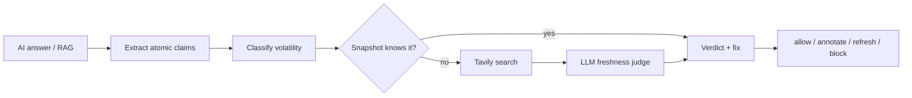

# StaleCheck

**Catch stale answers before your users do.**

StaleCheck is a freshness firewall for AI applications. It takes an LLM answer or RAG output,
breaks it into atomic claims, verifies the time-sensitive ones against fresh evidence, and
returns a verdict, the evidence, and a corrected statement — before the answer reaches a user.

> Global AI Hackathon — Tavily challenge: **Build a Stale-Answer Detector for AI Applications**.
> MVP scope: API + Python SDK + CLI + JS SDK + dashboard + eval suite, deployable entirely on
> free tiers.

**Live:** dashboard → https://stalecheck.pages.dev · API → https://stalecheck-api.onrender.com/health
(free tiers: Cloudflare Pages + Render).
**Demo video:** [`docs/StaleCheck-Demo.mp4`](docs/StaleCheck-Demo.mp4) · **Pitch deck:** [`docs/StaleCheck-Pitch-Deck.pptx`](docs/StaleCheck-Pitch-Deck.pptx)

---

## The problem

AI apps confidently serve outdated facts: superseded model names, old prices, deprecated API
endpoints, retired versions, people who no longer hold a role, and RAG answers grounded in docs
that were never updated. The model cannot tell that it is stale, and retrieval does not check
freshness. Users find out the hard way.

## The solution

A single check turns an answer into a claim-level freshness report:

| Verdict | Meaning |
|---|---|
| `fresh` | The claim matches current, sourced information. |
| `stale` | The claim contradicts current information; a `suggested_fix` is returned. |
| `unverifiable` | No source can settle it. StaleCheck never guesses. |

Then a policy decides what happens: `annotate`, `auto_refresh` (regenerate with corrected
facts), or `block`.



**Why this is cheap:** the snapshot resolves common topics for free; Tavily is only called for
claims it cannot settle, and low-volatility claims are skipped entirely. A demo runs on the
Tavily free tier and a rate-limited LLM.

---

## Quickstart (offline, no keys)

```bash
git clone <your-repo> stalecheck && cd stalecheck
uv sync                     # installs API + SDK + CLI + dev tools
uv run uvicorn stalecheck_api.main:app --reload --port 8000
```

In another terminal:

```bash
uv run stalecheck check "GPT-4o is the latest OpenAI model."
```

```text
STALE  score=1.00  action=annotate  provider=mock  4ms
┏━━━━━━━━━━━━━━━━━━━━━━━━━━━━━━━━━━━━━━┳━━━━━━┳━━━━━━━━━┳━━━━━━━━━━━━━━━━━━━━━━━━━━┓
┃ Claim                                ┃ Vol. ┃ Verdict ┃ Why                      ┃
┡━━━━━━━━━━━━━━━━━━━━━━━━━━━━━━━━━━━━━━╇━━━━━━╇━━━━━━━━━╇━━━━━━━━━━━━━━━━━━━━━━━━━━┩
│ GPT-4o is the latest OpenAI model.   │ high │ stale   │ Contradicts a dated fact │
└──────────────────────────────────────┴──────┴─────────┴──────────────────────────┘
  fix: GPT-5 is OpenAI's flagship model (released August 2025), succeeding GPT-4o.
```

Dashboard:

```bash
make web     # http://localhost:3000
```

### Live mode (Tavily + LLM)

```bash
cp .env.example .env
# set TAVILY_API_KEY, LLM_PROVIDER=groq, LLM_API_KEY
uv run uvicorn stalecheck_api.main:app --reload --port 8000
```

---

## What is in v1.0.0

- **API** — FastAPI service with claim extraction, volatility scoring, snapshot + Tavily
  verification, LLM judging, caching, run history, optional API-key auth.
- **Python SDK** — `stalecheck` client with sync/async checks and `guard_answer` middleware.
- **CLI** — `stalecheck check`, `scan` (CI-friendly exit codes), `stats`, `serve`, `version`.
- **JS SDK** — `@stalecheck/sdk` with `check`, `guardAnswer`, typed responses.
- **LangChain adapter** — `stalecheck-langchain` `StaleCheckCallbackHandler` for post-answer guarding.
- **Dashboard** — static Next.js app: checker with optional RAG context, claim drilldown,
  evidence links, run history, live stats.
- **Live mode** — Gemini (or any OpenAI-compatible) judge + Tavily live web, with offline
  snapshot/rule-based fallback.
- **Evals** — 44 labeled examples with precision/recall/F1, wired into CI as a regression gate.
- **Deploy** — root `Dockerfile`, `render.yaml`, `fly.toml`, HF Space template, free-tier guide,
  GitHub Actions web deploy to Cloudflare Pages.
- **Tests + CI** — pipeline/API/LangChain tests, ruff, eval gate, web and SDK builds.

---

## Repository layout

```
apps/api/stalecheck_api/   FastAPI app, pipeline, verifier, store, routes
apps/web/                  Next.js dashboard (static export)
packages/sdk-python/       `stalecheck` SDK + CLI
packages/sdk-js/           `@stalecheck/sdk`
evals/                     labeled dataset, runner, results
docs/                      architecture, API reference, free-tier deploy
```

---

## API

```bash
curl -s localhost:8000/v1/check \
  -H 'content-type: application/json' \
  -d '{"text":"GPT-4o is the latest OpenAI model.","mode":"annotate","use_web":true}'
```

| Endpoint | Purpose |
|---|---|
| `POST /v1/check` | Check text, return claim-level verdicts |
| `GET /v1/runs` | Recent runs |
| `GET /v1/runs/{id}` | Full run detail |
| `GET /v1/stats` | Aggregate stale rate and latency |
| `GET /health` | Liveness + provider mode |

Full reference: [`docs/api.md`](docs/api.md). Architecture: [`docs/architecture.md`](docs/architecture.md).

---

## SDKs

### Python

```python
from stalecheck import StaleCheck, guard_answer

sc = StaleCheck("http://localhost:8000")

result = sc.check("GPT-4o is the latest OpenAI model.")
print(result.verdict, result.claims[0].suggested_fix)

# Wrap any LLM answer with a policy
guarded = guard_answer(
    answer=answer,
    checker=sc,
    mode="auto_refresh",
    refresh=lambda r: llm(f"Correct this answer using: {r.claims[0].suggested_fix}"),
)
if guarded.is_stale:
    print("refreshed:", guarded.refreshed)
```

### JavaScript / TypeScript

```ts
import { StaleCheck, guardAnswer } from "@stalecheck/sdk";

const sc = new StaleCheck({ baseUrl: process.env.STALECHECK_URL! });

const result = await sc.check({ text: answer, mode: "annotate" });
if (result.verdict === "stale") {
  const guarded = await guardAnswer(sc, answer, {
    mode: "auto_refresh",
    refresh: (r) => regenerate(r.claims[0]?.suggested_fix),
  });
}
```

### CLI in CI

```bash
stalecheck scan docs/ --mode block
# exits 1 if any stale claims are found
```

---

## Evaluation

Offline (mock + snapshot) on the included 44-example suite:

| Label | Precision | Recall | F1 |
|---|---|---|---|
| fresh | 1.000 | 0.929 | 0.963 |
| stale | 1.000 | 0.778 | 0.875 |
| unverifiable | 0.706 | 1.000 | 0.828 |

Accuracy **0.886** (39/44). The five misses are deliberately kept as `hard-*` cases and
documented in [`evals/README.md`](evals/README.md); they are the cases the live LLM judge is
designed to resolve. Run it yourself:

```bash
make eval
```

---

## Deploy for $0

| Piece | Free option |
|---|---|
| API | Hugging Face Docker Space or Render free web service |
| Dashboard | Cloudflare Pages (static export) |
| Search | Tavily free tier (1,000/month) |
| LLM | Groq or Gemini free tier |
| DB | SQLite inside the API container |
| CI | GitHub Actions on a public repo |
| Domain | `*.pages.dev` / `*.hf.space` / `*.onrender.com` |

Step-by-step: [`docs/deploy.md`](docs/deploy.md).

```bash
docker build -t stalecheck-api .
docker run --rm -p 8000:8000 -v "$PWD/data:/data" --env-file .env stalecheck-api
```

---

## Roadmap to v1.0.0

| Version | Theme |
|---|---|
| **v0.1** | MVP: API, claim pipeline, snapshot + Tavily, Python SDK/CLI, JS SDK, dashboard, evals |
| v0.2 | Durable storage (Turso/Postgres), publish SDKs to PyPI/npm, framework middleware (LangChain shipped) |
| v0.3 | Auth, team workspaces, saved policies, scheduled re-checks |
| v0.4 | GitHub Action + CI regression gates, PR annotations |
| v0.5 | Optional Bifrost gateway in front of LLM calls (observability + caching) |
| v0.6 | Plugin packs: pricing, model deprecation, security advisories, legal |
| v0.7 | Community suites + public freshness leaderboard |
| v0.9 | Docs site, Docker image, self-host guide, migration tooling |
| **v1.0.0** | Stable semver API, migration guide, published eval corpus, pricing/SLA |

---

## Hackathon submission mapping

- **Primary theme:** Stale-Answer Detector (Tavily). No merged Bifrost integration, so no
  primary-theme conflict.
- **Repository:** public, this README covers install, implementation and technologies.
- **Pitch deck:** problem → stale example → pipeline → architecture → eval numbers → demo →
  roadmap.
- **Demo video:** paste a stale answer, watch it flagged, show the suggested fix and the run
  history.
- **Live demo:** optional; the free-tier deployment guide makes it a 15-minute task.

## Limitations

- The bundled snapshot is a **demo corpus** with an `as_of` date, not a live truth source. Set
  `TAVILY_API_KEY` + an LLM key for real verification.
- SQLite on free hosting is ephemeral; run history resets on restart.
- English-first heuristics. The live LLM path is language-agnostic.
- A public demo API should keep `API_KEY` unset; a static dashboard cannot hold a secret.

## License

MIT — see [`LICENSE`](LICENSE).
