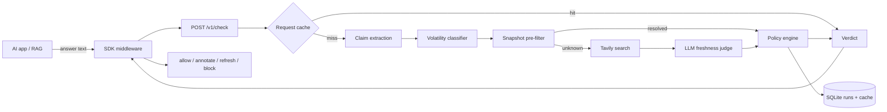

# Architecture

StaleCheck sits between an AI application and its users. It takes an answer (or RAG output),
splits it into atomic claims, decides which claims can go stale, verifies those against fresh
evidence, and returns a verdict plus a correction.



## Pipeline

1. **Claim extraction** — a prompt (or rule-based fallback) pulls atomic, checkable claims out
   of the answer. Only claims that *can* become outdated are kept: versions, prices, dates,
   people, model names, "latest/current" statements, API contracts.
2. **Volatility classification** — each claim gets `high`, `medium`, or `low`. Low-volatility
   claims are skipped; high/medium claims are candidates for verification. This is what keeps
   cost bounded.
3. **Snapshot pre-filter** — a bundled, dated knowledge snapshot resolves common topics for
   free. It is the entire offline/mock mode and the reason a demo costs nothing.
4. **Live verification (Tavily)** — only claims the snapshot cannot resolve trigger a Tavily
   search. This keeps usage well under the free tier (1,000 searches/month) and makes the
   product cheap at any scale.
5. **Freshness judge** — an LLM compares the claim against the retrieved evidence and returns
   `fresh`, `stale`, or `unverifiable`, with a confidence, a reason, and a corrected statement.
   Without an LLM key, the system falls back to rule-based verdicts (never invents a verdict).
6. **Policy** — `annotate` (show a warning), `auto_refresh` (regenerate with corrected facts),
   or `block` (refuse the answer). The pipeline records the action; the SDK enforces it.
7. **Cache + history** — verdicts are cached by input hash, and every run is stored for audit.

## Why this shape

- **Cheap by design.** The expensive path (search + LLM) only runs on volatile, unknown claims.
  Everything else is deterministic and free.
- **Honest verdicts.** `unverifiable` is a first-class result. The system never guesses.
- **Deployable anywhere.** One Python process, one SQLite file, no queue, no GPU.

## Code layout

```
apps/api/stalecheck_api/
  main.py        FastAPI app + lifespan wiring
  pipeline.py    orchestration, caching, policy
  llm.py         claim extraction + judge (Groq/Gemini/OpenAI compatible)
  snapshot.py    offline freshness knowledge base + matching heuristics
  tavily.py      live search client
  verifier.py    snapshot -> Tavily escalation
  store.py       SQLite run history + verdict cache
  schemas.py     request/response models
  routes/        /v1/check, /v1/runs, /v1/stats
  data/          bundled freshness snapshot
packages/sdk-python/   `stalecheck` SDK + CLI
packages/sdk-js/       `@stalecheck/sdk`
apps/web/              Next.js dashboard (static export)
evals/                 labeled dataset + precision/recall runner
```

## Data model

`runs` stores one row per check (input, verdict, score, action, claim counts, full JSON payload).
`cache` stores verdict payloads keyed by `sha256(text, context, mode, use_web, provider)` with a
TTL. Both live in a single SQLite file; the `Store` interface is intentionally small so it can be
swapped for Turso/Postgres in v0.2.

## Failure modes

- If Tavily is unreachable, the snapshot result still returns; unknown claims become
  `unverifiable`.
- If the LLM fails, extraction falls back to rules and live judging degrades to
  `unverifiable` rather than fabricating a verdict.
- If the database is read-only, the check still returns; persistence errors are logged.
